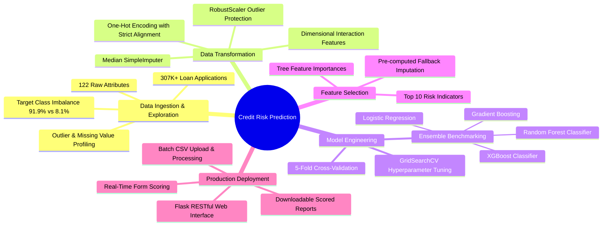
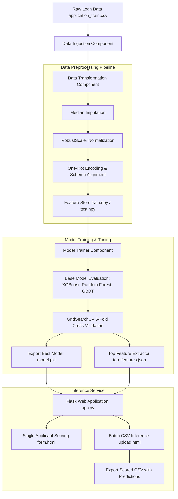

# 📊 Credit Risk Assessment & Default Prediction System

[](https://www.python.org/)
[](https://flask.palletsprojects.com/)
[](https://scikit-learn.org/)
[](https://xgboost.readthedocs.io/)
[](LICENSE)

An enterprise-ready, end-to-end Machine Learning pipeline and web platform designed to evaluate **credit default risk** for loan applicants. Built on financial data containing over **307,000+ customer records** and **120+ features**, this project automates data preprocessing, handles extreme class imbalance, trains tuned ensemble models, and delivers predictions through an interactive Flask web application supporting both **real-time single evaluations** and **high-throughput batch CSV processing**.

---

## 🧠 Project Mind Map

The mind map below highlights the core dimensions of the system from data sourcing to production serving:



---

## 🏗️ System Architecture Workflow



---

## 📑 Feature Engineering & Key Indicators

Through feature importance analysis on tree ensembles, the model isolates the **top 10 most influential risk drivers** used to optimize the real-time scoring interface:

| Rank | Feature Name | Description | Financial Interpretation |
| :---: | :--- | :--- | :--- |
| **1** | `EXT_SOURCE_3` | Normalized score from external data source 3 | Independent external credit risk rating |
| **2** | `EXT_SOURCE_2` | Normalized score from external data source 2 | Secondary credit bureau risk assessment |
| **3** | `DAYS_ID_PUBLISH` | Days before the application client changed ID | Identity and verification stability |
| **4** | `EXT_SOURCE_1` | Normalized score from external data source 1 | Primary credit bureau risk metric |
| **5** | `DAYS_REGISTRATION` | Days before application client modified registration | Residence and geographic stability |
| **6** | `DAYS_BIRTH` | Client's age in days (negative value) | Applicant maturity and career stage |
| **7** | `REGION_POPULATION_RELATIVE` | Normalized population of client's residential region | Regional economic strength & urban density |
| **8** | `DAYS_LAST_PHONE_CHANGE` | Days since the client updated contact phone | Contact stability and fraud resistance |
| **9** | `AMT_INCOME_TOTAL` | Total annual income of applicant | Direct debt-service capacity |
| **10** | `DAYS_EMPLOYED` | Days employed prior to loan application | Job security and income continuity |

### Domain-Specific Ratios Engineered:
* **Credit-to-Income Ratio:** $\text{AMT\_CREDIT} / \text{AMT\_INCOME\_TOTAL}$
* **Annuity-to-Income Ratio:** $\text{AMT\_ANNUITY} / \text{AMT\_INCOME\_TOTAL}$
* **Credit Term Duration:** $\text{AMT\_ANNUITY} / \text{AMT\_CREDIT}$
* **Employment-to-Age Ratio:** $\text{DAYS\_EMPLOYED} / \text{DAYS\_BIRTH}$

---

## 🤖 Models & Evaluation

The training framework executes comparative benchmark runs followed by grid search hyperparameter tuning:

| Model | Technique | Key Hyperparameters Evaluated | Primary Strength |
| :--- | :--- | :--- | :--- |
| **XGBoost Classifier** | Gradient Tree Boosting | `max_depth: [5, 7]`, `n_estimators: [10, 20]` | Superior speed & handles complex non-linear splits |
| **Random Forest** | Bagging Ensemble | `n_estimators: [100, 200]`, `max_depth: [5, 10]` | Resilient to overfitting on high-dimensional data |
| **Gradient Boosting** | Sequential Boosting | `n_estimators: [100]`, `criterion: friedman_mse` | Minimizes residual loss across iterations |
| **Logistic Regression** | Linear Classification | `C: [0.0001]`, L2 Regularization | High-interpretability baseline benchmark |

---

## 📂 Project Directory Structure

```text
CREDIT_PREDICTION_PROJECT/
│
├── .gitignore                      # Git exclusion rules for large datasets & venvs
├── README.md                       # Comprehensive documentation
├── app.py                          # Flask web application routes & endpoints
├── requirements.txt                # Required Python libraries and dependencies
│
├── artifacts/                      # Serialized pipelines and model assets
│   ├── model.pkl                   # Production-ready trained ML model
│   ├── preprocessor.pkl            # Imputer, Scaler, and categorical encoders
│   └── top_features.json           # Top 10 extracted features & feature means
│
├── config/                         # Configuration declarations
│   └── model.yaml                  # Model search spaces & GridSearchCV hyperparams
│
├── notebooks/                      # Exploratory analysis & prototyping
│   └── home_credit.ipynb           # Comprehensive EDA, correlations & experimentation
│
├── src/                            # Modular source code
│   ├── __init__.py
│   ├── exception.py                # Standardized custom exception handling
│   ├── logger.py                   # Automated file and console logging
│   │
│   ├── components/                 # Core pipeline stages
│   │   ├── __init__.py
│   │   ├── data_ingestion.py       # Raw dataset loading & train/test partitioning
│   │   ├── data_transformation.py  # Imputation, RobustScaler & categorical encoding
│   │   └── model_trainer.py        # Model benchmarking & GridSearchCV tuning
│   │
│   ├── pipeline/                   # Execution pipelines
│   │   ├── __init__.py
│   │   ├── train_pipeline.py       # End-to-end training orchestrator
│   │   └── predict_pipeline.py     # Single & batch inference pipeline
│   │
│   └── utils/                      # Helper utilities
│       ├── __init__.py
│       ├── extract_top_features.py # Feature importance extractor
│       └── main_utils.py           # Object serialization & YAML reader
│
├── templates/                      # Flask UI templates
│   ├── form.html                   # Interactive single applicant evaluation form
│   └── upload.html                 # Batch CSV file upload and download interface
│
└── tests/                          # Automated unit and integration tests
    ├── test_data_ingestion.py
    ├── test_data_transformation.py
    ├── test_extract_top_features.py
    ├── test_model_trainer.py
    ├── test_predict_pipeline.py
    └── test_train_pipeline.py
```

---

## 💻 Web Application Capabilities

| Feature | Single Prediction Mode (`/`) | Batch Prediction Mode (`/batch_predict`) |
| :--- | :--- | :--- |
| **Input Method** | Dynamic interactive HTML form | CSV file upload |
| **Features Required** | Top 10 key risk indicators (remaining filled via population means) | Full application CSV dataset |
| **Processing Time** | Real-time (< 100ms) | Asynchronous bulk processing |
| **Output Format** | Binary classification (`Default Risk` vs `Low Risk`) | Downloadable CSV with appended prediction column |
| **Target User** | Loan officer assisting in-person client | Credit Risk team conducting portfolio batch audits |

---

## 🚀 Quick Start & Installation

### 1. Prerequisites
* Python 3.10 or higher
* Git

### 2. Clone the Repository
```bash
git clone https://github.com/prakharmav/credit_risk.git
cd credit_risk
```

### 3. Set Up Virtual Environment
```bash
# Windows (PowerShell)
python -m venv .venv
.venv\Scripts\activate

# Linux / macOS
python3 -m venv .venv
source .venv/bin/activate
```

### 4. Install Dependencies
```bash
pip install -r requirements.txt
```

### 5. Launch the Web Application
```bash
python app.py
```
Open your browser and navigate to: **`http://127.0.0.1:5000/`**

---

## 🔄 Retraining the Pipeline

To re-execute data ingestion, preprocessing, and model training from scratch:

```bash
python -m src.pipeline.train_pipeline
```

The updated model and transformation pipelines will automatically be serialized into the `artifacts/` directory.

---

## 🧪 Running Unit Tests

Run test suites using `pytest`:

```bash
pytest tests/
```

---

## 👥 Author
* **Prakhar Raj** — [GitHub](https://github.com/prakharmav)

## 📄 License
This project is licensed under the MIT License — see the [LICENSE](LICENSE) file for details.
